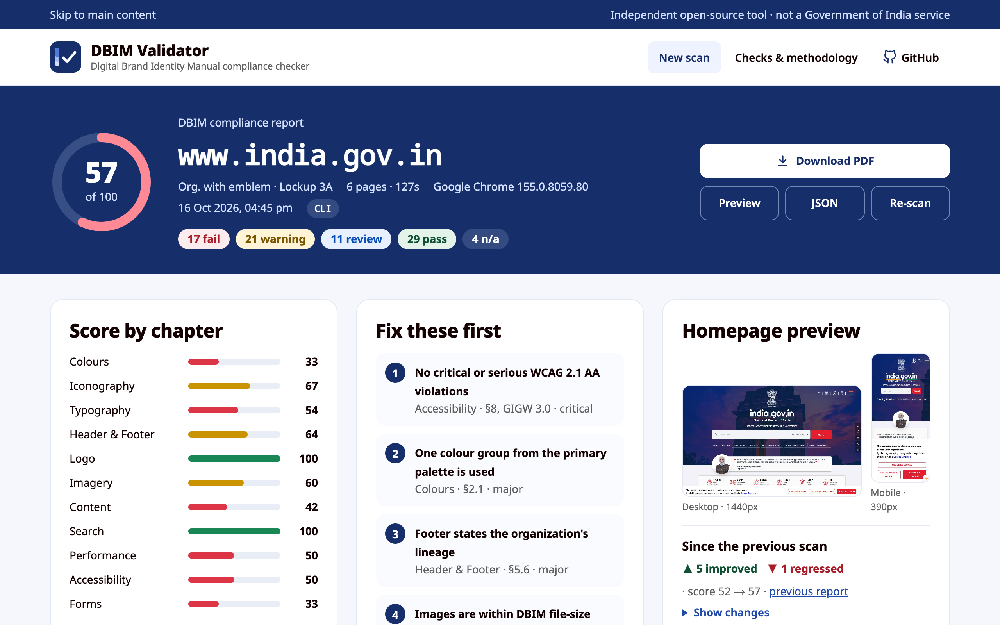
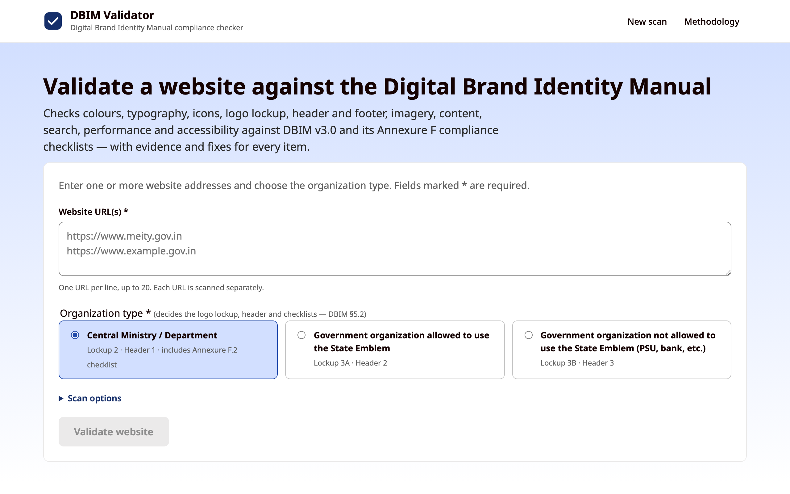
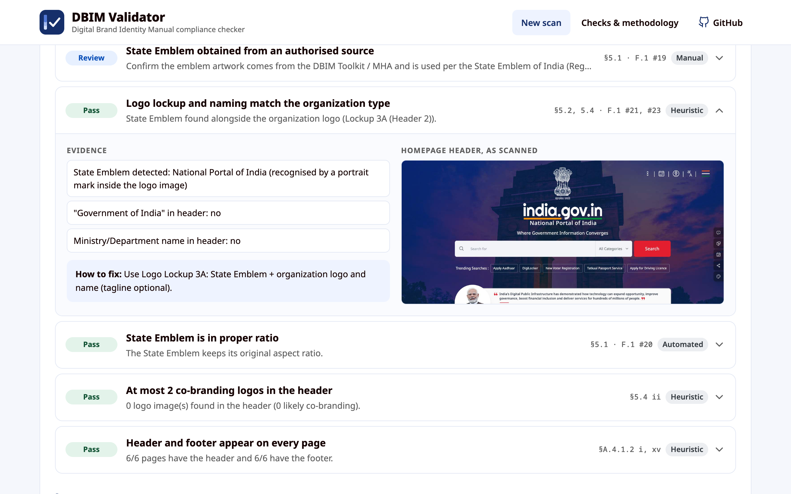

# DBIM Validator

**Check any Government of India website against the Digital Brand Identity Manual (DBIM) v3.0, automatically.**

[](https://github.com/tejash-jl/dbim-validator/actions/workflows/ci.yml)
[](LICENSE)
[-162F6A)](https://dbimtoolkit.digifootprint.gov.in/)


DBIM Validator is a free, open-source compliance checker for `gov.in` and `nic.in` websites. Paste a URL and it opens the site in a real browser, scans the homepage and key inner pages, and scores them against the **98 checks** of the [Digital Brand Identity Manual](https://dbimtoolkit.digifootprint.gov.in/) published by MeitY and NIC, including the **Annexure F** compliance checklists (F.1 for all organizations, F.2 for Ministries and Departments).

Every result cites the DBIM section and checklist item it comes from, shows the evidence (colours, selectors, file sizes, screenshots) and says how to fix it.



## Why

The DBIM asks every Ministry, Department and government organization to follow one visual and content standard: a single colour group, Noto Sans, a fixed type scale, specific logo lockups, mandatory header and footer elements, image budgets, accessible PDFs, cookie consent and more. The manual is 176 pages long and its compliance checklist is filled in by hand.

DBIM Validator automates what can be measured, flags what needs a human, and turns the checklist into a report a web team can act on.

**Who it's for:** web teams and vendors building government websites, NIC and department IT cells, auditors preparing for GIGW / STQC review, and anyone curious how compliant a government site is.

## Features

- **98 checks across every DBIM chapter:** colours, iconography, typography, header and footer, logo, imagery, content, search, performance, accessibility, Ministry information architecture and forms. [See every check →](docs/CHECKS.md)
- **Scans in real Google Chrome:** Playwright drives your installed Chrome (or Edge, or Chromium) at desktop (1440px) and mobile (390px) widths, so screenshots and measurements match what visitors see. It reads computed styles, network requests, hover states, sticky headers, cookies and the search box. When you run it locally, Chrome opens on screen so you can watch the scan (untick *Show the browser while scanning* to hide it).
- **Test sites before they go live:** scan sites running on your machine or local network (`localhost:3000`, `127.0.0.1`, `192.168.x.x`), so you can fix DBIM issues during development.
- **Organization-aware:** choose *Ministry / Department*, *organization with the State Emblem* or *organization without it*, and the expected logo lockup, header type and checklist follow (DBIM §5.2).
- **Accessibility and performance:** axe-core WCAG 2.1 AA audit, Lighthouse scores and Core Web Vitals, link checking and tagged-PDF analysis.
- **AI review (optional):** with an Anthropic API key, Claude judges the visual and writing checks a rule can't measure, such as logo lockup, icon style, banner text in images and plain language.
- **Actionable reports:** a score out of 100, scores per chapter, evidence and a fix for every check, screenshots, PDF and JSON export, and the changes since the previous scan of the same site.
- **Batch and CLI:** scan up to 20 URLs at once from the web app, or run `npm run scan -- <url>` in CI.
- **Safe to host:** in production, private and internal addresses are blocked (SSRF protection), requests are rate-limited and the queue is capped.

<table>
<tr>
<td></td>
<td></td>
</tr>
</table>

## Quick start

Requires Node.js 20 or later.

```bash
git clone https://github.com/tejash-jl/dbim-validator.git
cd dbim-validator
npm install
npx playwright install chromium   # fallback browser, used if Google Chrome isn't installed
npm run dev
```

Open http://localhost:3000, paste a URL such as `https://www.india.gov.in`, choose the organization type and select **Validate website**. A full scan with Lighthouse takes about 3–4 minutes.

### Testing a site on your machine

Start your site as usual (for example `npm run dev` on port 5173), then scan `localhost:5173` from the web app or the CLI. Addresses without a scheme default to `http://` for local hosts.

- Local and private-network URLs are allowed when you run DBIM Validator with `npm run dev` or the CLI, and blocked under `npm start` unless you set `ALLOW_PRIVATE_URLS=1`.
- The HTTPS check is marked N/A for local sites, and the report notes that caching, compression and performance reflect your dev server rather than production.
- If nothing is listening on the port, the scan fails with "Nothing is running at localhost:5173".

To enable the AI-assessed checks, copy `.env.example` to `.env.local` and set `ANTHROPIC_API_KEY`, or set `DBIM_AI_PROVIDER=bedrock` with AWS credentials to use Claude in Amazon Bedrock. Without it those checks are shown as "needs review" and the scan still works.

### Command line

```bash
npm run scan -- https://www.meity.gov.in --org ministry --pages 6 --json report.json
npm run scan -- localhost:5173 --org org-emblem              # your local site; Chrome opens so you can watch
```

| Flag | Meaning |
|---|---|
| `--org ministry \| org-emblem \| org-no-emblem` | Organization type (default `ministry`) |
| `--pages N` | Homepage plus up to N−1 inner pages (default 6; the web app allows up to 15) |
| `--json file` | Write the full report as JSON |
| `--browser chrome \| msedge \| chromium` | Browser to scan with (default `chrome`, falls back to Chromium) |
| `--headless` | Don't show the browser (shown by default when there's a display; always hidden in CI) |
| `--block-private` | Refuse localhost and private-network URLs (allowed by default in the CLI) |
| `--no-lighthouse --no-ai --no-links --no-pdfs` | Skip the slower stages |
| `--dry-run` | Don't save the scan to the web app; screenshots go to `data/cli/` |

Command-line scans are saved to the same database as the web app, so they appear in **Recent scans** marked **CLI**, with live progress while they run and a full report (PDF and JSON export, re-scan, changes since the previous scan) when they finish. The CLI prints the report's link at the end. Use `--dry-run` for throwaway runs.

### Production

```bash
npm run build && npm start   # runs next start and the scan worker together
```

## How it works

```
Next.js UI + API  ──►  SQLite job queue  ──►  worker (scripts/worker.ts)
                                               ├─ Google Chrome via Playwright, desktop 1440px + mobile 390px
                                               │   (computed styles, network log, DOM, hover, search, cookies, axe-core)
                                               ├─ crawl: homepage + key inner pages from the nav and footer
                                               ├─ link checker, PDF tag analysis (pdf-lib), Lighthouse
                                               ├─ Claude visual and content review (optional)
                                               └─ rules engine → scored report + screenshots
```

Each check is one of four types:

| Type | Meaning |
|---|---|
| **Automated** | Measured directly in the rendered page |
| **Heuristic** | Inferred from text and structure; may need confirmation |
| **AI-assessed** | Judged by Claude from screenshots and page text |
| **Manual** | Can't be verified from outside the website (e.g. image licences, minister names); listed for the team to confirm |

The score weights each check by severity (critical 3, major 2, minor 1): pass counts fully, a warning counts half, a failure counts zero, and manual and N/A items are excluded.

### Project layout

| Path | Contents |
|---|---|
| `src/lib/dbim/spec.ts` | DBIM values: palettes, type scale, icon sizes, limits, text patterns |
| `src/lib/dbim/rules/` | One module per chapter; each rule declares its DBIM section, checklist item, severity and organization types |
| `src/lib/scanner/` | Browser collection, crawler, link and PDF checks, Lighthouse, AI review, SSRF guard |
| `src/app/`, `src/components/` | Web app and API |
| `scripts/` | Scan worker, CLI, docs generator |
| `docs/CHECKS.md` | Generated list of every check (`npm run docs:checks`) |

### Configuration

| Variable | Purpose |
|---|---|
| `ANTHROPIC_API_KEY` | Enables the AI-assessed checks |
| `ANTHROPIC_WORKSPACE_ID` | Workspace to use with an organization-level API key (not needed for a workspace-scoped key) |
| `DBIM_AI_PROVIDER` | `anthropic` (default, uses `ANTHROPIC_API_KEY`) or `bedrock` (Claude in Amazon Bedrock, uses AWS credentials and `AWS_REGION`) |
| `DBIM_AI_MODEL` | Model for AI checks (default `claude-opus-5-5`) |
| `WORKER_CONCURRENCY` | Scans run in parallel (default 2) |
| `PAGE_CONCURRENCY` | Inner pages of one scan collected in parallel (default 3) |
| `SCAN_TIMEOUT_MS` | Time limit per scan (default 15 minutes) |
| `DBIM_DATA_DIR` | Where the SQLite database and screenshots are stored (default `./data`) |
| `APP_ORIGIN` | Public origin of the app, used for PDF export and page metadata |
| `DBIM_BROWSER` | `chrome` (default), `msedge` or `chromium`. Uses the installed browser and falls back to Playwright's Chromium |
| `DBIM_HEADED=1` | Show browser windows for scans that don't say otherwise (the web form and CLI already show them locally by default) |
| `ALLOW_PRIVATE_URLS` | `1` allows localhost and private-network URLs, `0` blocks them. Default: allowed in development and the CLI, blocked in production |

## FAQ

**What is the DBIM?**
The Digital Brand Identity Manual is the Government of India's design and content standard for its digital presence, published by the Ministry of Electronics and Information Technology (MeitY) with the National Informatics Centre (NIC). Version 3.0 (January 2025) covers colours, typography, iconography, logo lockups, header and footer, imagery, content, accessibility, search and performance, with compliance checklists in Annexure F.

**How do I check whether my website is DBIM compliant?**
Run DBIM Validator on the site's URL. The report lists every Annexure F checklist item it can test, with pass, warning or fail, and the items your team must confirm by hand.

**Is this an official government tool?**
No. It's an independent open-source project based on the published manual. A high score does not certify a website and does not replace GIGW 3.0 or STQC certification.

**Does it replace a GIGW 3.0 audit?**
No. It covers the DBIM, plus an automated WCAG 2.1 AA check through axe-core. GIGW and STQC audits include manual accessibility testing and process reviews that no scanner can do.

**Why did the scan of a site fail or get blocked?**
Many government sites use bot protection. The scanner uses a real browser with a normal user agent, which works on most sites, but some may still refuse automated visits. If a site doesn't respond within 60 seconds the report says so; check whether it opens from your network at all. Two common cases are handled automatically: sites that only answer on `https://` (an `http://` address that hangs is retried over HTTPS), and sites that use "DevTools not allowed" scripts such as `disable-devtool`, which would otherwise redirect an automated browser to a blank page.

**Can I test a website that's still on my machine?**
Yes. Run your site locally and scan `localhost:<port>` (or a `192.168.x.x` address on your network). See [Testing a site on your machine](#testing-a-site-on-your-machine).

**Which browser does it use?**
Your installed Google Chrome by default, so rendering matches what visitors see. Set `DBIM_BROWSER=msedge` for Edge or `DBIM_BROWSER=chromium` for Playwright's Chromium (handy on servers without Chrome). The browser and version are shown on every report.

**Can I use it in CI?**
Yes. `npm run scan -- <url> --json report.json` exits after the scan; read `score` or the `results` array from the JSON.

## Known limitations

- The State Emblem is found by name, by its shape next to "Government of India" context, or as a detailed portrait mark inside a logo image. An emblem in a cross-origin image with no telling name can't be inspected, so the check asks you to confirm it.
- Heuristic checks (text patterns, navigation labels) can misfire on unusual sites. Please [report false positives](https://github.com/tejash-jl/dbim-validator/issues/new?template=false-positive.yml).
- The colour group is detected from each group's key colour and two mid shades only; the two lightest tints are too close to ordinary off-whites to tell groups apart.
- Content that a site pulls in server-side (for example from CCPS) is invisible to the browser, so the CCPS check may fail wrongly.
- Lighthouse runs its own Chrome, which blocks only well-known internal hostnames. When hosting publicly, keep `ALLOW_PRIVATE_URLS` off and run the worker in a network-isolated environment.
- The manual itself has a few errata: Deep Blue is printed as `#1DOA69` (read as `#1D0A69`), §A.5.6 refers to a "Section 5.7" that doesn't exist, and title limits differ between F.2 #16 (150 characters) and §A.5.3 (250). The validator warns above 150 characters and fails above 250.

## Contributing

Contributions are welcome, especially false-positive reports from real government sites, Hindi and regional-language text patterns, and new checks. See [CONTRIBUTING.md](CONTRIBUTING.md).

## License

[MIT](LICENSE) © Tejash JL

*DBIM Validator is not affiliated with or endorsed by MeitY, NIC or the Government of India. "Digital Brand Identity Manual" and the State Emblem belong to their respective owners.*
